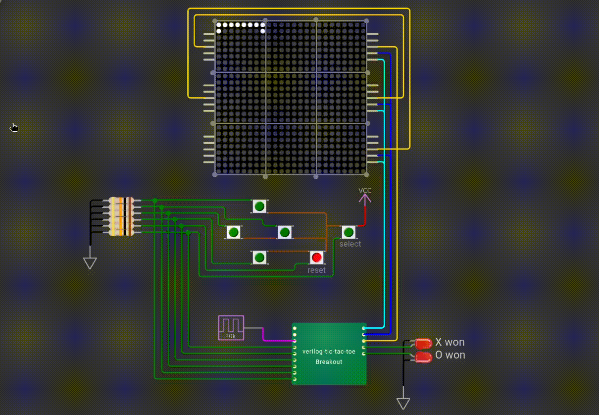

# Verilog Tic-Tac-Toe

A work-in-progress tic-tac-toe game written in Verilog and built in the online Wokwi simulator. The game uses 9 chained MAX7219 modules for its display.

## Progress

- [x] Set up the Wokwi simulation
- [x] Connect and configure nine chained MAX7219 modules
    - [x] Display number of each matrix (1 to 9) for testing
    - [x] Highlight selected cell
- [x] Read the up, right, down, left, select, and reset push buttons
    - [x] Add button debouncing
- [x] Handle player inputs
    - [x] up,right,down,left buttons controlls selected cell
    - [x] Pressing the Select button sets the selected cell’s value to either X or O
    - [x] Handle restart button
- [ ] Detect wins
- [ ] Implement infinite Tic-Tac-Toe
    - [ ] After a player has made 3 moves, remove their oldest move when they make their next move
    - [ ] Add a blinking visual effect to the cell that will be removed on the next turn

## Simulation

